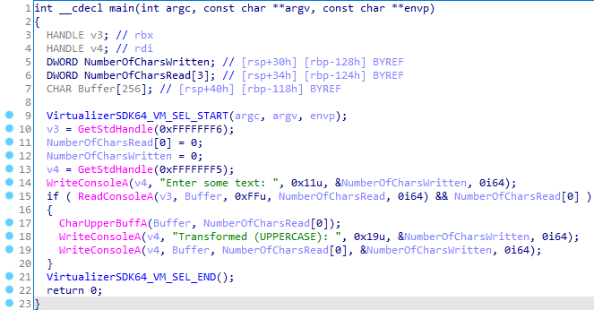
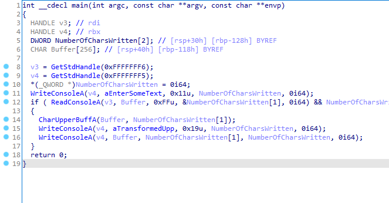

# Themida Devirtualizer Example

Thanks to years of public research on Themida and binary deobfuscation, I was able to build a lifter targeting it.

This project demonstrates static devirtualization of code protected by **Themida** (Tiger White). Below is a side-by-side comparison showing the function **before virtualization** and **after devirtualization**.

| Before Virtualization | After Devirtualization |
|-----------------------|------------------------|
|  |  |

## Acknowledgements

- https://aftermathlabs.net/blog/09/05/2026/
- https://secret.club/author/fvrmatteo
- https://github.com/jonathansalwan/triton
- https://github.com/ergrelet/unlicense/
